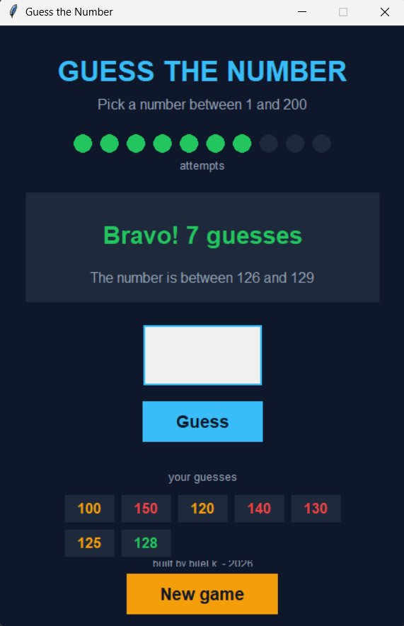

# Number Guessing Game

A number guessing game in Python with two versions: a **command-line version** and a **graphical version** built with Tkinter. The computer picks a secret number between 1 and 200, and you try to find it using "too small" / "too big" hints.

Built by Bilel K. while finishing [CS50P](https://cs50.harvard.edu/python/) (Harvard's Introduction to Programming with Python).



## Two versions

| | CLI version | GUI version |
|---|---|---|
| File | `guessing_game.py` | `interface_with_ai.py` |
| Interface | Terminal | Tkinter window |
| Attempts | Unlimited | 10 attempts, shown as dots |
| Input check | Rejects non-numbers | Rejects non-numbers and numbers outside 1-200 |
| Hints | Too small / too big | Too small / too big, plus the remaining range |
| Restart | Run the script again | "New game" button |

## Getting started

**Requirements:** Python 3. Tkinter is included with the standard Python installer on Windows and macOS. On some Linux distributions, install it with `sudo apt install python3-tk`.

```bash
git clone https://github.com/YOUR-USERNAME/guessing-game.git
cd guessing-game
```

Run the command-line version:

```bash
python guessing_game.py
```

Run the graphical version:

```bash
python interface_with_ai.py
```

## How to play

1. The game picks a secret number from 1 to 200.
2. Type a guess and press Enter.
3. The game tells you whether your guess is too small or too big.
4. Keep guessing until you find the number.

In the GUI version, you have 10 attempts. Each guess is saved as a colored chip: amber means too small, red means too big, and green means correct.

### Example run (CLI)

```
Give me your guess ::: 20
Your guess is too small !!!
Give me your guess ::: 100
Your guess is too small !!!
Give me your guess ::: 150
Your guess is too small !!!
Give me your guess ::: 200
Your guess is too big !!!
Give me your guess ::: 180
Your guess is too small !!!
Give me your guess ::: 190
Your guess is too big !!!
Give me your guess ::: 185
Your guess is too big !!!
Give me your guess ::: 183
Your guess is too small !!!
Give me your guess ::: 184
Bravo, Your guess is correct after 9 guesses ::: [20, 100, 150, 200, 180, 190, 185, 183, 184]
```

**Tip:** always guess the middle of the remaining range (binary search). With this strategy you can find any number from 1 to 200 in at most 8 guesses.

## How it works

Both versions share the same core idea: compare the player's guess with the secret number and return one of three results.

```python
def hints(player, secret):
    if secret > player:
        return 'small'
    elif secret < player:
        return 'big'
    else:
        return 'right'
```

This function only compares and returns a value. It does not print or read input, so it is easy to reuse and to test.

### CLI version

| Function | Role |
|---|---|
| `main()` | Picks the secret number with `random.randint(1, 200)` and runs the game loop. It reads each guess with `input()` and handles invalid input with `try` / `except ValueError`. |
| `rounding()` | Stores each guess in a list with `append()`. |
| `hints()` | Compares the guess with the secret number and returns `'small'`, `'big'` or `'right'`. |
| `result()` | Prints the message the player sees: the hint, or the winning message with the list of all guesses. |

The loop runs until the player guesses correctly, then ends with `sys.exit()`.

### GUI version

The GUI is a class, `GuessGame`, that extends `tkinter.Tk` and reuses the same hint logic.

| Method | Role |
|---|---|
| `build_ui()` | Creates the title, the attempt dots, the message card, the input field, the buttons and the guess history. |
| `new_game()` | Picks a new secret number and resets the guesses, the range and the display. |
| `on_guess()` | Reads and validates the input, saves the guess, shows the hint and checks for a win or a loss. |
| `draw_dots()` | Draws one dot per attempt used (blue while playing, green on a win, red on a loss). |
| `add_chip()` | Adds the guess to the history, colored by its result. |
| `finish()` | Ends the round by disabling the input field. |
| `show_error()` | Shows an error message when the input is not a whole number from 1 to 200. Invalid input does not use an attempt. |

The game also narrows the range as you play. After a "too small" answer the lower bound moves up, and after a "too big" answer the upper bound moves down, so the message "The number is between X and Y" always shows what is still possible.

## Project structure

```
guessing-game/
├── guessing_game.py        # command-line version
├── guessing_game_gui.py    # Tkinter version
├── images/
│   └── gui-screenshot.png
└── README.md
```

## What I practiced

- Functions and return values
- Lists and `append()`
- The `random` module
- Exception handling with `try` / `except`
- Loops and conditionals
- Basic GUI programming with Tkinter (classes, widgets, events)

## Known limitations and next steps

- [ ] The CLI version accepts any integer, so enforce the 1-200 range there as well
- [ ] Add a "play again?" option and an attempt limit to the CLI version
- [ ] Add unit tests for the hint function with `pytest`
- [ ] Move the shared hint logic into one module used by both versions

## About

The CLI version and the game logic are my own work, written while learning Python with CS50P. The graphical version was created with the help of an AI assistant, built on top of that logic.

