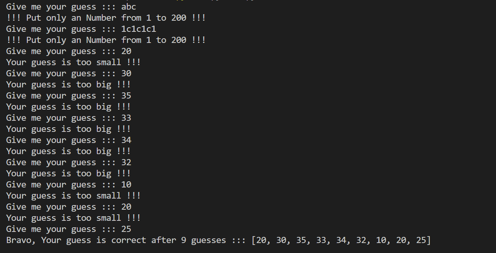

# Number Guessing Game

A command-line number guessing game written in Python, built while finishing CS50P (Harvard's Introduction to Programming with Python).

The computer picks a secret number between 1 and 200, and you try to guess it. After every guess you get a hint: too big or too small.

## Demo



```
Give me your guess ::: abc
!!! Put only a number from 1 to 200 !!!
Give me your guess ::: 100
Your guess is too small !!!
Give me your guess ::: 200
Your guess is too big !!!
Give me your guess ::: 184
Bravo, Your guess is correct after 3 guesses ::: [100, 200, 184]
```

## How to run

You need Python 3 installed.

```
python guessing_game.py
```

## How it works

| Function | What it does |
|----------|--------------|
| `main()` | Runs the game loop: picks the secret number, reads the player's guess with `input()`, and calls the other functions. |
| `hints()` | Compares the guess with the secret number and returns `'small'`, `'big'`, or `'right'`. |
| `rounding()` | Stores each guess in a list using `append()`. |
| `result()` | Prints the message the player sees, such as "Your guess is too big !!!" or the winning message with the list of guesses. |

Invalid input (letters or symbols instead of a number) is handled with `try` and `except` to catch the `ValueError`, so the game doesn't crash.

## What I practiced

- Functions and return values
- Lists and `append()`
- The `random` module
- Exception handling with `try` / `except`
- Loops with `while True`

## Try to do those :

- Reject numbers outside the range 1 to 200
- Add a "play again?" option
- Limit the number of guesses

Thank you for checking out my project!


